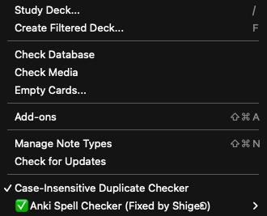

<div align="center">

# Case-Insensitive Duplicate Checker

**Catch duplicates even when capitalization differs.**

<a href="https://github.com/j0m0k0/anki-case-insensitive-duplicate-checker/stargazers"></a>
<a href="https://github.com/j0m0k0/anki-case-insensitive-duplicate-checker/actions/workflows/tests.yml"></a>
<a href="LICENSE"></a>

This add-on prevents duplicate notes that differ only by capitalization. For example, if a note's first field contains `apple`, adding another note with `Apple`, `APPLE`, or `aPpLe` is recognized as a duplicate. Anki shows its usual duplicate highlight and **Show Duplicates** control.

</div>

## Anki's familiar duplicate UI

The add-on uses Anki's own duplicate highlight and **Show Duplicates** control. It does not add a separate warning or editor element.

<p align="center">
  
</p>

Enable or disable it from **Tools → Case-Insensitive Duplicate Checker**. A checkmark means it is on.

## What it checks

- The first field of notes of the same note type.
- Capitalization differences, including Unicode case variants.
- Field text with HTML formatting ignored.
- The note currently being edited is excluded from matching.

Only the first field is compared; other fields are ignored. Exact-spelling duplicates continue to be handled by Anki's built-in checker. Toggle the case-insensitive check from **Tools → Case-Insensitive Duplicate Checker**. When disabled, Anki's normal duplicate behavior is unchanged. Add-ons run on Anki Desktop; AnkiMobile and AnkiDroid do not support them.

## Install

Build an installable package from the source:

```sh
git clone https://github.com/j0m0k0/anki-case-insensitive-duplicate-checker.git
cd anki-case-insensitive-duplicate-checker
python3 build_addon.py
```

Then in Anki, choose **Tools → Add-ons → Install from file**, select `dist/Case-Insensitive-Duplicate-Checker.ankiaddon`, and restart Anki.

## Build and test

```sh
python3 -m unittest discover -s tests -v
python3 build_addon.py
```

The package is written to `dist/Case-Insensitive-Duplicate-Checker.ankiaddon`. It contains only the required add-on files and needs no third-party Python packages. GitHub Actions runs the tests and packaging check on Windows, macOS, and Linux with Python 3.10 and 3.13.

## Compatibility

Targeted at Anki 26.09 and later. Check the supported version range on the AnkiWeb listing before installing; add-ons can require updates when Anki changes its internals.

## Feedback and contributions

If this add-on helps, please [⭐ star the repository](https://github.com/j0m0k0/anki-case-insensitive-duplicate-checker). Found a bug or have a feature idea? [Open an issue](https://github.com/j0m0k0/anki-case-insensitive-duplicate-checker/issues). Contributions are welcome.

## License

Licensed under the [GNU Affero General Public License v3.0 or later](LICENSE) (AGPL-3.0-or-later).
